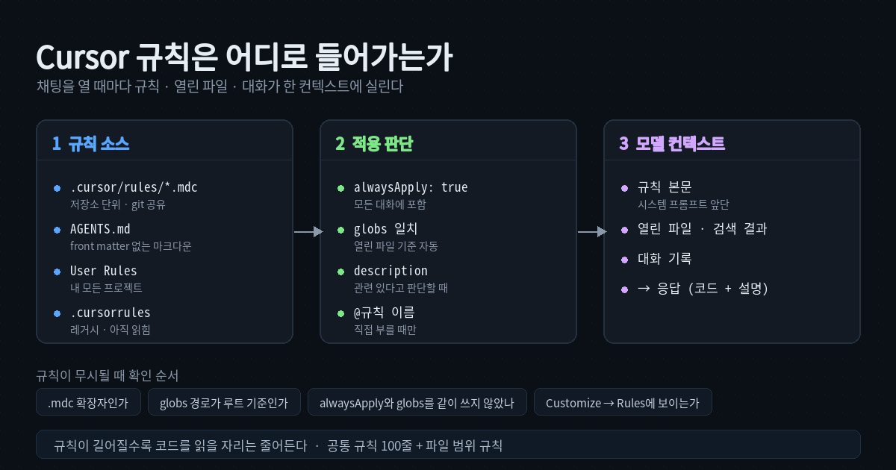

Cursor로 새 채팅을 열고 "로그인 API 만들어줘"라고 치면, 첫 번째 답은 그럴듯하다. 두 번째 채팅에서 비슷한 요청을 하면 조금 달라진다. 세 번째쯤 되면 이미 있는 `httpClient.ts`를 두고 `axios`를 새로 설치하겠다고 한다. 프로젝트는 Next.js App Router에 Supabase를 쓰는데, 답변에는 `pages/api` 구조가 섞여 들어온다.

모델이 나빠진 게 아니다. Cursor는 채팅 세션 사이에 아무것도 기억하지 못한다. 내가 머릿속에 있는 "이 프로젝트는 이렇게 생겼다"를 매번 다시 말해주지 않으면, 모델은 인터넷에 흔한 평균적인 Next.js 프로젝트를 상상해서 답한다. 그 상상이 내 저장소와 어긋나는 순간부터 수정 요청이 시작된다.

이 글은 그 반복을 규칙 파일 하나로 끊는 이야기다. 예시는 실제로 쓰는 형태 그대로 두었고, 마지막에는 규칙을 길게 쓰고 싶은 유혹이 왜 역효과인지도 적었다.

## 규칙 파일이 실제로 하는 일

Cursor의 규칙은 시스템 프롬프트에 미리 붙는 텍스트다. 채팅을 시작할 때 모델 컨텍스트 맨 앞에 규칙이 들어가고, 그 뒤에 내가 연 파일과 대화가 붙는다. 즉 규칙은 "요청할 때마다 반복해서 말하던 문장"을 한 파일로 옮겨 놓은 것에 가깝다. 마법 같은 코드베이스 학습이 아니라, 매번 같은 자리에 같은 설명을 꽂아 넣는 장치다.

2026년 11월 기준으로 Cursor가 읽는 규칙은 네 종류다.



규칙 소스에서 시작해 적용 여부를 거쳐 모델 컨텍스트 앞단에 붙고, 그 뒤에 내가 연 파일과 대화가 이어진다.

| 종류 | 위치 | 적용 범위 |
| --- | --- | --- |
| Project Rules | `.cursor/rules/*.mdc` | 저장소 단위, git으로 공유 |
| `.cursorrules` (레거시) | 저장소 루트 | 저장소 단위. 아직 읽히지만 deprecated |
| `AGENTS.md` | 저장소 루트와 하위 폴더 | 저장소 단위, front matter 없는 순수 마크다운 |
| User Rules | Cursor 설정 | 내 계정의 모든 프로젝트 |

`.cursorrules`는 원래 이 용도로 유일한 파일이었고 지금도 루트에 두면 읽힌다. 다만 Cursor 공식 문서와 헬프센터는 이 파일을 레거시로 부르고 `.cursor/rules` 또는 `AGENTS.md`로 옮기라고 안내한다. 공식 문서 기준의 이전 절차는 단순하다.

1. 명령 팔레트에서 `New Cursor Rule`을 실행한다.
2. `.cursorrules` 내용을 새 규칙 파일에 붙여 넣는다.
3. 적용 방식을 `Always Apply`로 둔다. 기존 `.cursorrules`와 같은 동작이다.
4. 루트의 `.cursorrules`를 지운다.

기존 `.cursorrules`가 남아 있어도 당장 빌드가 깨지는 건 아니다. 다만 `.mdc` 규칙과 겹치면 `.mdc` 쪽이 우선하므로, 두 파일에 서로 다른 말을 적어두면 왜 규칙이 안 먹는지 한참 헤매게 된다. 새로 시작하는 프로젝트라면 처음부터 `.cursor/rules`에 넣는 편이 낫다.

## 규칙에 꼭 넣는 다섯 가지

규칙 파일을 처음 쓰면 보통 "깔끔하게 작성해줘", "좋은 코드를 짜줘" 같은 문장부터 나온다. 이런 규칙은 모델을 조금도 바꾸지 못한다. 모델은 이미 "깔끔한 코드"가 무엇인지 알고 있고, 내 프로젝트에서 그것이 무엇을 뜻하는지만 모른다. 그 간극을 메우는 정보만 규칙으로 가치가 있다.

**1. 스택과 버전.** 프레임워크, 언어, 스타일 도구, 패키지 매니저, 그리고 버전. `Next.js 15 App Router`와 `Next.js 13 pages`는 완전히 다른 프로젝트다. 모델은 최신 문서를 기준으로 답하니, 구버전을 쓰고 있다면 그 사실을 먼저 알려야 한다.

**2. 명령어.** 빌드·테스트·타입 체크·린트 명령을 그대로 적는다. `pnpm vitest run --changed`처럼 옵션까지 적어두면, 모델이 테스트를 돌려 결과를 확인하는 흐름까지 스스로 처리한다. `npm test`로 추측했다가 존재하지 않는 스크립트를 실행하는 일이 줄어든다.

**3. 디렉터리 책임.** "`src/lib`는 외부 API 호출과 순수 로직, `src/components`는 표현만" 같은 한 줄이 신규 파일 위치를 거의 결정한다. 규칙이 없으면 모델은 `utils/`, `helpers/`, `services/`를 마음대로 만든다.

**4. 금지 사항.** 규칙 중에서 가장 효과가 크다. 모델은 기본값으로 `axios`, `moment`, `any`, `styled-components`를 잘 꺼내 든다. "쓰지 말고 무엇을 쓰라"는 형태로 적는 게 핵심이다. "axios 쓰지 마"보다 "HTTP는 `src/lib/http.ts`의 `httpGet`/`httpPost`만 사용"이 훨씬 잘 지켜진다. 대체 수단을 주면 모델이 판단할 여지가 줄어든다.

**5. 예시 한 조각.** 규칙 열 줄보다 실제 파일 하나가 정확할 때가 많다. 규칙 본문에 코드를 복사하지 말고 `@src/lib/http.ts`처럼 파일을 가리키면, 모델이 필요할 때 직접 읽는다. 문서에 적힌 그대로다. 단, `@파일` 언급은 내용을 프롬프트에 복사하지 않으므로, 반드시 항상 봐야 하는 내용은 규칙 본문에 직접 써야 한다.

## 실제로 쓰는 규칙 파일

프로젝트 하나에 공통 규칙 파일 하나를 두고, 나머지는 파일 범위로 쪼개는 구성이다. `alwaysApply: true`인 공통 규칙은 매 대화에 붙고, 100줄을 넘기지 않게 유지한다.

```md
---
description: 프로젝트 공통 규칙 — 스택, 명령어, 금지 사항
alwaysApply: true
---

# 스택
- Next.js 15 (App Router), React 19, TypeScript 5.6 strict
- 스타일: Tailwind CSS 4 유틸리티만. CSS-in-JS, styled-components, emotion 금지
- 데이터: Supabase(Postgres). 클라이언트는 @supabase/ssr 사용
- 패키지 매니저: pnpm. package-lock.json, yarn.lock 만들지 말 것
- 날짜: date-fns만 사용. moment, dayjs 금지

# 명령어
- 개발 서버: pnpm dev
- 타입 체크: pnpm typecheck
- 테스트: pnpm vitest run --changed
- 린트: pnpm lint (자동 수정은 pnpm lint:fix)

# 구조와 책임
- src/app: 라우트와 레이아웃만. 데이터 가공 로직 두지 말 것
- src/components: 표현 컴포넌트. 서버 액션 호출 금지
- src/lib: 순수 로직, 외부 API 호출, Supabase 쿼리
- src/lib/http.ts 외부 fetch 직접 호출 금지. httpGet/httpPost 사용

# 코드 규칙
- any 금지. 불가피하면 unknown + 타입 가드
- 컴포넌트는 함수 선언 + named export. default export는 page/layout만
- 새 의존성 추가 전에 package.json에 이미 있는지 확인하고, 추가하면 이유를 답변에 적을 것
- 에러는 throw 대신 { code, message } 형태로 반환 (src/lib/errors.ts 참고)

# 금지
- .env*, supabase/migrations 기존 파일 수정 금지. 마이그레이션은 새 파일로만
- src/lib 하위 로직 변경 시 테스트 없는 커밋 금지
- 생성물(.next, out) 수정 금지
```

파일 범위 규칙은 front matter의 `globs`로 나눈다. 아래 규칙은 `src/app/api`에 있는 파일을 대화에 열었을 때만 자동으로 붙는다.

```md
---
description: API 라우트 응답 형식과 검증 규칙
globs: src/app/api/**/*.ts
alwaysApply: false
---

- 모든 라우트는 zod로 입력을 검증하고, 실패 시 400과 { code: "INVALID_INPUT", issues }
- 성공 응답은 { data } 또는 { error } 형태만 허용. 그 외 키 금지
- 인증이 필요한 라우트는 src/lib/auth/requireUser.ts를 먼저 통과시킬 것
- 캐시 헤더는 기본 no-store. 공개 GET만 revalidate 지정
```

front matter 세 필드의 관계는 단순하다. `alwaysApply: true`면 다른 값과 상관없이 항상 들어간다. `false`이고 `globs`가 있으면 해당 경로 파일이 컨텍스트에 들어올 때 자동 적용된다. `globs` 없이 `description`만 있으면 에이전트가 설명을 읽고 필요할 때 스스로 가져간다. 셋 다 없으면 채팅에서 `@규칙이름`으로 부를 때만 쓰인다.

이 구조의 장점은 규칙을 늘려도 공통 파일이 두꺼워지지 않는다는 점이다. API 규칙을 추가하고 싶으면 `.cursor/rules/api-routes.mdc`를 새로 만들면 되고, 프론트엔드 작업 중에는 그 규칙이 아예 로드되지 않는다.

## 규칙이 안 먹힐 때 확인하는 것

규칙을 써놓고 "왜 또 axios를 쓰지" 싶을 때, 대부분은 규칙 내용이 아니라 로딩 문제다. 순서대로 확인하면 대개 세 번째 안에서 끝난다.

**확장자.** `.cursor/rules` 안의 `.md` 파일은 규칙으로 인식되지 않는다. front matter로 적용 방식을 지정할 수 없기 때문이다. `.mdc`여야 한다. 순수 마크다운으로 쓰고 싶으면 `AGENTS.md`를 쓴다.

**경로 기준.** `globs`는 저장소 루트 기준이다. `src/**/*.tsx`는 맞고 `./src/**/*.tsx`나 `**/src/**`는 의도와 다르게 동작할 수 있다. 패턴 여러 개는 쉼표로 구분한다.

**alwaysApply와 globs를 같이 쓴 경우.** `alwaysApply: true`면 `globs`는 무시된다. 특정 파일에만 적용하려던 규칙이 모든 대화에 붙어 컨텍스트를 잡아먹고 있었다면 이 조합을 의심한다.

**실제 로드 여부.** Cursor 설정의 Rules 화면이나 사이드바의 Customize → Rules에서 규칙 목록과 적용 상태를 볼 수 있다. 여기에 안 보이면 파일 위치나 확장자 문제다. 반대로 보이는데 답이 다르면, 다른 규칙이나 User Rules와 충돌하는 경우가 많다. 같은 내용을 두 곳에 두면 모델이 어느 쪽을 따를지 예측하기 어려워진다. 공통 규칙은 한 곳에만 둔다.

**코드와 규칙의 불일치.** 규칙에는 `httpGet`만 쓰라고 했는데 저장소 곳곳에 `fetch`가 남아 있으면, 모델은 실제 코드를 더 신뢰한다. 규칙을 쓰는 김에 위반 사례를 정리해두는 게 좋다. 규칙은 선언이고, 코드는 증거라서 증거가 이긴다.

## 길게 쓰면 망가지는 지점

규칙을 쓰다 보면 회사 위키의 코딩 컨벤션을 통째로 옮기고 싶어진다. 400줄짜리 `.cursorrules`를 만든 뒤 "앞부분은 지키는데 뒤로 갈수록 무시한다"는 경험을 하게 된다. 이유는 두 가지다.

첫째, 규칙은 길수록 좋은 게 아니라 **같은 자리를 두고 경쟁**한다. 컨텍스트에는 규칙, 열린 파일, 대화 기록, 검색된 코드가 함께 들어간다. 규칙이 1만 토큰을 차지하면 그만큼 실제 코드를 읽을 여유가 줄어든다. 모델이 내 파일을 덜 읽고 규칙을 더 읽으면, 결과물은 내 코드베이스가 아니라 규칙에 적힌 일반론에 가까워진다.

둘째, 긴 규칙은 서로 모순되기 쉽다. "컴포넌트는 함수형으로" 옆에 "클래스 기반 서비스 패턴 유지"가 있으면 모델은 둘 다 만족시키려다 이상한 중간 형태를 만든다. 사람이 읽어도 헷갈리는 문서를 모델이 정확히 해석할 이유는 없다.

Cursor 문서도 규칙은 500줄 아래로 유지하고, 큰 규칙은 여러 개로 쪼개고, 스타일 가이드 전체를 복사하지 말고 린터에 맡기라고 안내한다. 개인적으로는 200~300줄을 넘기면 체감이 확 나빠졌다. 같은 실수를 반복해서 한 줄씩 늘리는 방식이면 대개 그 선을 넘지 않는다.

줄이는 방법은 세 가지다.

- **린터로 넘긴다.** 들여쓰기, 따옴표, import 순서는 ESLint와 Prettier가 이미 잡는다. 규칙에 적어도 모델이 더 잘 지키지 않는다.
- **파일로 넘긴다.** 템플릿, 응답 형식, 에러 객체는 본문에 복사하지 말고 `@파일`로 가리킨다. 코드가 바뀌어도 규칙이 낡지 않는다.
- **반복되는 실수만 남긴다.** 한 번 발생한 엣지 케이스는 규칙이 아니라 그 대화에서 설명하면 된다. 규칙은 "세 번 이상 반복된 실수"의 목록이어야 한다.

## 규칙도 코드처럼 관리한다

효과가 좋은 규칙 파일은 처음부터 완성되지 않는다. 빈 파일로 시작해서, 모델이 같은 실수를 할 때마다 한 줄씩 추가하는 편이 낫다. 두 시간 동안 머릿속 컨벤션을 문서화하는 것보다, 실제로 세 번 틀린 다음 그 한 줄을 적는 쪽이 정확하다.

저장소에 커밋해 두면 팀 전체가 같은 규칙으로 작업한다. 규칙 변경도 PR로 올려 리뷰를 받으면, "이 조항은 우리 코드와 안 맞는다"는 논의가 코드 리뷰에서 그대로 이어진다. 분기에 한 번쯤은 읽어보고 더 이상 해당하지 않는 조항을 지운다. 예전에 쓰던 라이브러리 이름이 남아 있는 규칙은 없느니만 못하다.

마지막으로 남는 건 세 가지다. 스택과 명령어, 금지 사항, 디렉터리 책임을 100줄 안쪽으로 적고 나머지는 파일 범위 규칙으로 쪼갠다. 규칙이 안 먹으면 확장자와 globs, alwaysApply 조합부터 확인한다. 그리고 규칙이 길어질수록 좋아지는 게 아니라 실제 코드를 읽을 자리를 빼앗는다는 것만 기억하면, 400줄짜리 `.cursorrules`를 만드는 일은 없을 것이다.
